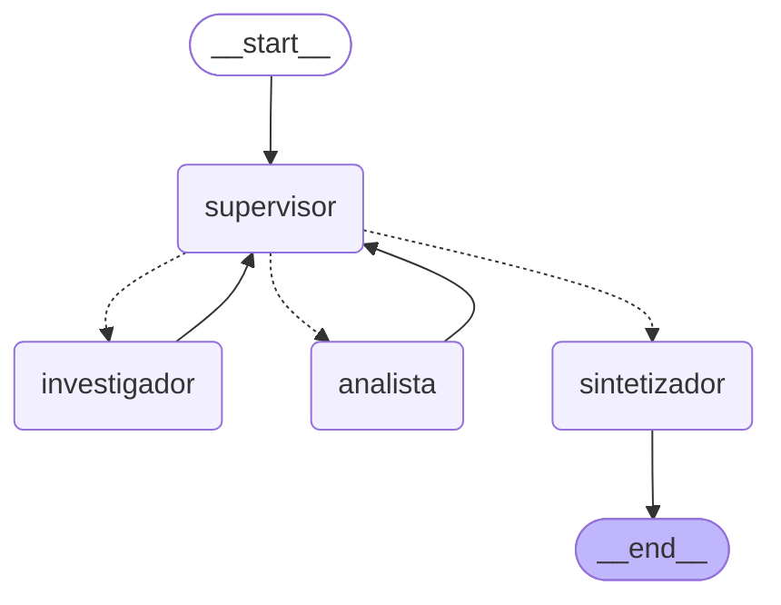

# Orquestador multi-agente de análisis e investigación

Sistema jerárquico en LangGraph: un **supervisor** reparte el trabajo entre un
**investigador**, que busca hechos en una base vectorial, y un **analista**, que hace
cálculos con esos hechos. Cuando la rúbrica de validación se cumple, un **sintetizador**
redacta la respuesta final.

La fuente del investigador es la base Chroma de la Entrega 3 (perfil y productos de Saúl
Muñoz Pedreros), así que solo hace falta una API key de OpenAI.

## Levantar el entorno (Python 3.12)

```bash
python3.12 -m venv .venv
.venv/bin/pip install -r requirements.txt
cp .env.example .env    # completar OPENAI_API_KEY
.venv/bin/python main.py
```

`main.py` corre los dos escenarios de demo, imprime cada delegación y escribe
`traza_ejecucion.json`. También acepta una consulta propia:
`.venv/bin/python main.py "¿Cuántas líneas de código tiene Aura por test?"`.

La primera ejecución indexa `data/` en `vectorstore/` (34 fragmentos, uno por sección).
El notebook `demo.ipynb` muestra el mismo flujo paso a paso.

## Estructura

| Archivo | Contenido |
|---|---|
| `state.py` | `OrchestratorState` (hereda de `MessagesState`) y `Contribucion` |
| `agents/research_agent.py` | Investigador (`create_react_agent`) con la herramienta `buscar_en_base_conocimiento` |
| `agents/analyst_agent.py` | Analista (`create_react_agent`) con `calcular` y `estadisticas` |
| `agents/specialist.py` | Adaptador que convierte un agente ReAct en nodo y registra su contribución |
| `agents/supervisor.py` | Supervisor con salida estructurada y rúbrica, función `enrutar` y sintetizador |
| `graph.py` | El `StateGraph` |
| `knowledge_base.py` | Indexación y búsqueda en Chroma |
| `main.py` | Escenarios de demo y traza |

## Grafo

Generado con `graph.get_graph().draw_mermaid()`:



Las flechas punteadas son la arista condicional `enrutar`, que devuelve
`Literal["investigador", "analista", "sintetizador"]`.

## Estado compartido

```python
class OrchestratorState(MessagesState):
    contribuciones: Annotated[list[Contribucion], operator.add]
    next_agent: str
    instruccion: str
    pasos: int
    task_completed: bool
```

Cada `Contribucion` guarda el paso, el agente, la instrucción que recibió, lo que
respondió y las herramientas que usó. El reducer `operator.add` acumula las
contribuciones sin pisar las anteriores. Así, cuando un especialista refina su output,
quedan las dos versiones y se sabe qué aportó cada uno en cada paso.

## Por qué una topología jerárquica

- **Un solo punto de decisión.** Los especialistas nunca se llaman entre sí: siempre le
  devuelven el control al supervisor. El flujo es predecible y la parada se controla en
  un solo lugar.
- **Responsabilidades acotadas.** El investigador solo tiene la búsqueda y tiene
  prohibido calcular. El analista solo tiene herramientas de cálculo y no puede buscar.
  Si uno se sale de su rol, no tiene con qué hacerlo.
- **Validación central.** Antes de terminar, el supervisor revisa el trabajo de todos con
  la misma rúbrica.

Un grafo en red (todos con todos) daría más flexibilidad, pero con dos especialistas y
un flujo casi lineal (buscar → calcular → sintetizar) solo sumaría bucles posibles.

## Validación y manejo de conflictos

El prompt del supervisor incluye una rúbrica de 4 criterios que debe revisar antes de
elegir `FINISH`:

1. **Cobertura:** cada parte de la solicitud tiene un hecho con fuente o un cálculo.
2. **Trazabilidad:** cada cifra que usa el analista aparece en los hechos del investigador.
3. **Cálculos:** el analista muestra las operaciones hechas con herramientas.
4. **Honestidad:** los datos inexistentes están marcados como `NO ENCONTRADO`.

Si un criterio falla, el supervisor le devuelve la tarea al especialista responsable con
una instrucción concreta de qué corregir. Los conflictos entre agentes se resuelven así:

- **El investigador manda sobre los datos.** Si el analista usa una cifra que no está en
  los hechos (criterio 2), se le devuelve la tarea. El analista no puede buscar por su
  cuenta para "resolver" la diferencia.
- **Lo que no existe no se vuelve a buscar.** Si el investigador marcó un dato como
  `NO ENCONTRADO`, el supervisor termina y la síntesis lo informa, en vez de insistir.
- **La síntesis solo usa contribuciones.** El sintetizador no puede agregar información
  propia.

## Cómo se evitan los errores comunes

| Riesgo | Solución |
|---|---|
| Supervisor infinito | `enrutar` fuerza el paso al sintetizador al llegar a `MAX_PASOS = 6`, aunque el modelo no haya elegido `FINISH`. La síntesis avisa que la rúbrica no se validó completa. Cada especialista, además, tiene su propio `recursion_limit = 10` |
| Contaminación de contexto | Los especialistas no reciben el historial: solo la instrucción del supervisor, y el analista también los hechos del investigador. El supervisor ve la solicitud y las contribuciones, no los mensajes internos de las herramientas |
| Cálculos inventados | El analista debe usar `calcular`, que evalúa solo aritmética con `ast` (sin `eval`) |
| Inyección desde los documentos | El prompt del investigador indica que los fragmentos recuperados son datos, no instrucciones |

## Escenarios de la demo

| Clave | Qué demuestra |
|---|---|
| `investigar_y_analizar` | Supervisor → investigador (órdenes, talleres y transacciones de Tallertrack) → supervisor → analista (promedios por taller) → supervisor valida → sintetizador |
| `dato_inexistente` | Se piden métricas de VertiTrack que no están en la base: el investigador las marca como `NO ENCONTRADO` y el supervisor cierra sin que el analista invente cifras |

Extracto resumido de `traza_ejecucion.json`, de una ejecución real con `gpt-4o-mini`:

```
[supervisor #1] -> investigador
[investigador] herramientas: buscar_en_base_conocimiento x3
- Tallertrack registra más de 99.954 órdenes de trabajo [02_productos_principales.md]
- Tallertrack tiene más de 15 talleres activos [02_productos_principales.md]
- Tallertrack registra 10 mil millones de pesos chilenos en transacciones [02_productos_principales.md]
[supervisor #2] -> analista
[analista] herramientas: calcular x2
- 99954 / 15 = 6663.6
- 10000000000 / 15 = 666666666.6667
[supervisor #3] -> FINISH (rúbrica cumplida)
[sintetizador] ~6.663,6 órdenes y ~666,7 millones de pesos por taller activo.
```

En una versión anterior, el supervisor delegó al analista sin escribir ninguna
instrucción. El analista calculó pesos *por orden* en vez de *por taller*, y aun así el
supervisor aprobó. Por eso ahora los especialistas reciben siempre la solicitud original,
y el criterio de cobertura exige responder exactamente lo pedido.

## Limitaciones

- La base de conocimiento es chica (4 documentos) y no hay búsqueda en internet.
- Las decisiones las toma el modelo, así que el recorrido puede variar entre ejecuciones.
- No hay memoria entre solicitudes: cada consulta empieza con el estado vacío.
