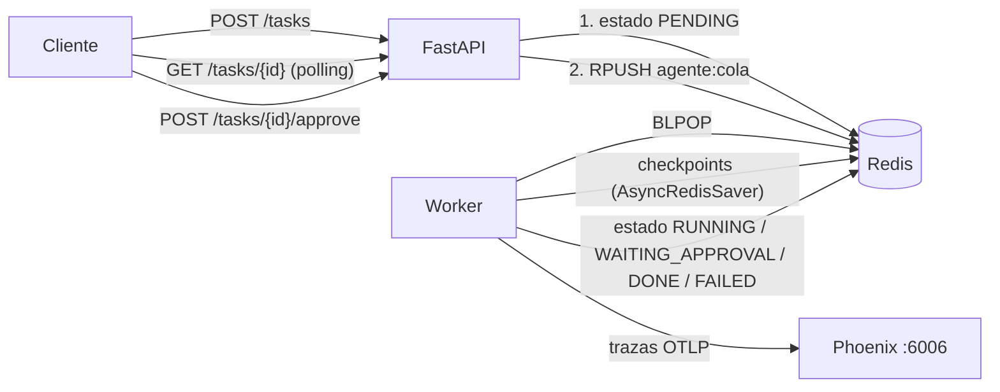

# Pre-entrega 7: API de producción y monitoreo activo

API REST con FastAPI que expone el orquestador multi-agente de la Entrega 6 (supervisor →
investigador / analista → sintetizador). La API no ejecuta el grafo: encola el pedido en
Redis y responde con un `job_id` en milisegundos. Un **worker** aparte ejecuta el grafo,
guarda los checkpoints de LangGraph en Redis y envía las trazas de cada nodo a **Arize
Phoenix**. Las tareas críticas se pausan hasta que una persona las aprueba.



## Estructura

```
Entrega 7/
├── app/
│   ├── main.py            # FastAPI: POST /tasks, GET /tasks/{id}, GET /health
│   ├── worker.py          # consume la cola, ejecuta el grafo, actualiza el estado (incluye FAILED)
│   ├── graph.py           # orquestador del M6 + nodos HITL, compilado con AsyncRedisSaver
│   ├── hitl.py            # reglas de criticidad, nodo con interrupt() y POST /tasks/{id}/approve
│   ├── observability.py   # init de Phoenix (OpenInference / OpenTelemetry)
│   ├── jobs.py            # lectura y escritura del estado de cada job en Redis
│   ├── knowledge_base.py  # Chroma, con un span RETRIEVER propio
│   ├── agents/            # supervisor, investigador, analista (Entrega 6)
│   ├── state.py · config.py
├── data/                  # base de conocimiento (4 documentos)
├── scripts/
│   ├── carga_concurrente.py   # las 5 peticiones concurrentes
│   └── metricas_phoenix.py    # costo por ejecución y p95, leídos de Phoenix
├── screenshots/           # evidencia del dashboard
├── docker-compose.yml     # redis + phoenix + api + worker
├── Dockerfile · requirements.txt · .env.example
```

## Cómo levantarlo

### Opción A: Docker Compose (recomendada)

```bash
cp .env.example .env          # completar OPENAI_API_KEY
docker compose up -d --build
curl localhost:8000/health    # {"redis":true,"en_cola":0}
```

| Servicio | URL |
|---|---|
| API (docs interactivas) | http://localhost:8000/docs |
| Phoenix (dashboard) | http://localhost:6006 |
| Redis | localhost:6379 |

La primera vez, el worker indexa `data/` en Chroma y descarga el modelo de embeddings
(unos 80 MB, que queda en el volumen `chroma-models`). Cuando está listo, el log muestra `Worker listo` (`docker compose logs -f worker`).

### Opción B: local (Python 3.12+)

```bash
docker run -d --name redis -p 6379:6379 redis:8.10.3
docker run -d --name phoenix -p 6006:6006 -e PHOENIX_ENABLE_AUTH=false arizephoenix/phoenix:version-21.2.1

python3.12 -m venv .venv
.venv/bin/pip install -r requirements.txt
cp .env.example .env          # completar OPENAI_API_KEY

.venv/bin/uvicorn app.main:app --port 8000     # terminal 1: API
.venv/bin/python -m app.worker                 # terminal 2: worker
```

Hace falta **Redis 8** (o `redis-stack`), porque el checkpointer usa los módulos RediSearch
y RedisJSON.

## Endpoints

| Método | Ruta | Qué hace |
|---|---|---|
| `POST` | `/tasks` | Body `{"query": "...", "publicar": false}`. Guarda el estado `PENDING`, encola y responde `202` con el `job_id` |
| `GET` | `/tasks/{job_id}` | Estado, resultado, error o la solicitud de aprobación. `404` si no existe |
| `POST` | `/tasks/{job_id}/approve` | Body `{"aprobado": true, "comentario": "..."}`. `409` si el job no está esperando aprobación |
| `GET` | `/health` | Ping a Redis y largo de la cola |

Ciclo de vida de un job:

```
PENDING → RUNNING → DONE
                  ↘ FAILED                      (cualquier excepción del grafo)
                  ↘ WAITING_APPROVAL → (approve) → PENDING → RUNNING → DONE
```

```bash
curl -X POST localhost:8000/tasks -H "Content-Type: application/json" \
     -d '{"query": "¿Cuántas líneas de código tiene Aura por cada test?"}'
curl localhost:8000/tasks/<job_id>
```

## Decisiones de diseño

### API que no bloquea

- Los endpoints son `async` y solo hablan con Redis mediante el cliente asíncrono
  (`redis.asyncio`). Ninguno llama al LLM ni a Chroma.
- **El estado se escribe antes de encolar.** Si el worker fuera más rápido que la escritura,
  el polling recibiría un 404 de un job que sí existe.
- El worker es un **proceso aparte** (`python -m app.worker`) y corre hasta
  `WORKER_CONCURRENCY` grafos a la vez con un semáforo. Toma el cupo *antes* de hacer el
  `BLPOP`: si está lleno, el mensaje queda en Redis para otra instancia. Para escalar se
  levantan más workers (`docker compose up -d --scale worker=3`).
- Chroma es síncrono, pero el `ToolNode` de LangGraph ejecuta las herramientas síncronas en
  un hilo aparte, así que el event loop del worker nunca se bloquea.

### Persistencia en Redis

| Clave | Contenido |
|---|---|
| `agente:job:<id>` | JSON con estado, consulta, resultado, error, solicitud de aprobación y tiempos |
| `agente:cola` | Lista de mensajes `{"job_id", "tipo": "start" \| "resume"}` |
| `checkpoint:*` | Checkpoints de LangGraph (`AsyncRedisSaver`), con `thread_id = job_id` |
| `agente:informes_publicados` | Salida de la acción crítica (solo se escribe con aprobación) |

**Manejo de errores:** `procesar()` envuelve toda la ejecución en un `try/except`. Ante
cualquier excepción (API key inválida, timeout de OpenAI, `GraphRecursionError`, etc.),
el job pasa a `FAILED` con el tipo y el mensaje del error, así el cliente deja de hacer
polling. Para probarlo sin romper nada se puede mandar `"simular_fallo": true`, que fuerza
un `GraphRecursionError` real.

### Human-in-the-loop

El grafo de la Entrega 6 suma dos nodos al final:

```
supervisor ⇄ investigador / analista → sintetizador → aprobacion_humana → entregar → END
```

`aprobacion_humana` decide con reglas deterministas (no con el modelo) si la tarea es crítica:

1. **Efecto secundario:** se pidió `"publicar": true`, lo que escribe el informe en un canal
   externo (simulado con la lista `agente:informes_publicados`).
2. **Respuesta no validada:** el supervisor llegó a `MAX_PASOS` sin aprobar la rúbrica, así
   que la respuesta salió del freno de seguridad y no de una validación.

Si es crítica, `interrupt()` guarda el estado en Redis y corta la ejecución. El worker deja
el job en `WAITING_APPROVAL` con los motivos y el borrador. `POST /approve` encola un
mensaje `resume`, y el worker continúa el mismo `thread_id` con `Command(resume=decision)`.
El efecto secundario vive en el nodo `entregar`, **después** del `interrupt()`, porque al
reanudar LangGraph vuelve a ejecutar el nodo pausado desde el principio.

Como el checkpoint está en Redis, **el job se puede aprobar después de reiniciar el worker o
la API**, o desde otra instancia:

```bash
curl -X POST localhost:8000/tasks -H "Content-Type: application/json" \
     -d '{"query": "¿Cuántas líneas de código tiene Aura por cada test?", "publicar": true}'
curl localhost:8000/tasks/<job_id>            # WAITING_APPROVAL, con motivos y borrador
docker compose restart worker api             # el estado sobrevive al reinicio
curl -X POST localhost:8000/tasks/<job_id>/approve -H "Content-Type: application/json" \
     -d '{"aprobado": true, "comentario": "Cifras verificadas"}'
curl localhost:8000/tasks/<job_id>            # DONE, entrega: "publicado en agente:informes_publicados"
docker compose exec redis redis-cli LRANGE agente:informes_publicados 0 -1
```

Con `"aprobado": false`, el job termina en `DONE` con `aprobacion: "rechazada"` y no se
publica nada.

### Observabilidad con Arize Phoenix

`observability.py` registra un `TracerProvider` de OpenTelemetry que exporta a Phoenix, y
activa `LangChainInstrumentor` de OpenInference. Con eso, cada nodo del grafo, cada llamada
a OpenAI (con tokens de entrada y salida) y cada herramienta quedan como spans anidados, sin
tener que decorar función por función. Además:

- **Chroma tiene su propio span `RETRIEVER`** (`knowledge_base.py`), con la consulta y los
  documentos recuperados con su score. Sin él, el tiempo de la base vectorial quedaría
  escondido dentro del span de la herramienta. El span se cuelga de la herramienta que lo
  llamó: `investigador → tools → buscar_en_base_conocimiento → chroma.query`.
- `using_session(job_id)` agrupa en una misma **sesión** de Phoenix la traza inicial y la de
  reanudación de un job con HITL.
- Cada traza lleva como metadata el `job_id` y el `prompt_version` (para saber qué versión
  de los prompts produjo cada respuesta) y tags `start` / `resume`.
- El exportador corre en batch (`batch=True`), así que enviar spans no frena al agente.

Phoenix calcula el **costo** de cada traza a partir de los tokens de los spans LLM y de su
tabla de precios por modelo (`gpt-4o-mini`).

## Prueba de carga: 5 peticiones concurrentes

1. Partir con datos limpios, para no mezclar corridas en el p95:
   ```bash
   docker compose down -v && docker compose up -d --build
   docker compose logs -f worker    # esperar "Worker listo" y salir con Ctrl+C
   ```
2. Lanzar las 5 peticiones a la vez (cada una hace polling hasta terminar):
   ```bash
   .venv/bin/python scripts/carga_concurrente.py
   ```
   El script muestra, por job, cuánto tardó el `POST` (debe estar en milisegundos aunque el
   grafo tarde decenas de segundos) y la latencia total que vio el cliente, con su p50 y p95.
3. Leer las mismas métricas desde Phoenix, para contrastarlas con las capturas:
   ```bash
   .venv/bin/python scripts/metricas_phoenix.py
   ```

### Qué capturar en `/screenshots`

| Archivo | Dónde en Phoenix |
|---|---|
| `01_trazas_proyecto.png` | Proyecto `pre-entrega-7` → pestaña *Traces*: las 5 trazas con latencia, tokens y costo por fila |
| `02_costo_y_latencia_p95.png` | Encabezado del proyecto (*Total Cost*, latencias) o pestaña *Metrics* con el percentil p95 |
| `03_jerarquia_spans.png` | Una traza abierta: árbol `orquestador → supervisor → investigador → tools → buscar_en_base_conocimiento → chroma.query` y los spans LLM |
| `04_span_llm_tokens.png` | Un span `ChatOpenAI`: prompt, respuesta, tokens de entrada y salida |
| `05_retriever_chroma.png` | El span `chroma.query`: documentos recuperados con score |
| `06_hitl_sesion.png` | Pestaña *Sessions*: un job con `publicar: true` con sus dos trazas (`start` y `resume`) |
| `07_traza_failed.png` | Una traza con estado ERROR (`"simular_fallo": true`) |

### Lectura del dashboard

Corrida del 19-11-2026 con `gpt-4o-mini`, 5 peticiones concurrentes, Phoenix limpio
(`scripts/metricas_phoenix.py` da los mismos números que el dashboard):

| Métrica | Valor |
|---|---|
| Estado | 5/5 `DONE` |
| `POST /tasks` más lento | 7,9 ms (la API no espera al grafo) |
| Latencia por traza, p50 / p95 | 11,6 s / **13,7 s** |
| Tokens totales | 21.252 de entrada + 2.440 de salida |
| Costo total / **por ejecución** | 0,00465 USD / **0,00093 USD** (de 0,00051 a 0,00121 USD) |

**Dónde se concentra la latencia.** En las llamadas al LLM: 37 spans `ChatOpenAI` que
suman 52,4 s, con 1,2 a 1,6 s cada uno. Eso es latencia de red y de inferencia en OpenAI. El
procesamiento local es mínimo: `chroma.query` tarda 0,46 s en promedio (embedding + búsqueda),
`calcular` menos de 1 ms, y los nodos `aprobacion_humana` y `entregar` 1 ms. Cada traza es
una cadena secuencial de 5 a 7 llamadas al LLM (supervisor → investigador → supervisor →
analista → supervisor → sintetizador), y eso explica los 11 a 14 s.

**Hallazgo: arranque en frío de Chroma.** En la primera corrida, el p95 fue de **75,9 s**. Los
spans `chroma.query` mostraron que las 10 primeras búsquedas, lanzadas al mismo tiempo,
tardaron entre 39 y 65 s cada una, mientras que el LLM seguía en 1 a 2 s. La causa: Chroma
carga el modelo ONNX de embeddings recién en el primer query, y las 10 búsquedas compitieron
por esa carga. Con una consulta de calentamiento al iniciar el worker (`worker.py`), el p95
bajó a 13,7 s con el mismo costo. Sin el span de la base vectorial, el tiempo habría
aparecido como "lentitud de la herramienta" y el sospechoso habría sido el LLM.

**Qué nodo consume más tokens.** El supervisor: 9.945 tokens (42 % del total), contra 7.240
del investigador, 4.585 del analista y 1.922 del sintetizador. Decide 2 o 3 veces por tarea,
y cada vez recibe su prompt de sistema completo (la rúbrica) más todas las contribuciones
acumuladas, así que el prompt crece en cada paso. La traza más cara (6.005 tokens,
0,00121 USD) es la de Tallertrack: 3 decisiones del supervisor y 3 búsquedas.

**Cómo reducirlo.**
- Pasarle al supervisor un resumen de cada contribución, no el texto completo. Es lo que
  más pesa en su prompt de entrada.
- Atajo determinista: si el investigador solo devolvió `NO ENCONTRADO`, ir directo al
  sintetizador sin otra decisión del LLM. En VertiTrack ya cerró en 2 pasos, pero lo decidió el modelo.
- Usar prompt caching de OpenAI: el prompt de sistema del supervisor es idéntico en todas las
  llamadas, así que dejarlo al principio y sin cambios abarata los tokens de entrada repetidos.

**Grounding.** Las 5 respuestas se basan en el contexto recuperado: cada cifra (99.954
órdenes, 15 talleres, 4.200 líneas y 89 tests, 32 horas semanales, 1.700 productos y 150
vehículos) aparece en los documentos recuperados por `chroma.query`, y los cálculos salen de
spans `calcular`. En la consulta sobre VertiTrack, que no tiene esos datos, el sistema
respondió `NO ENCONTRADO` en vez de inventar cifras. Lo único que se podría objetar: en Forestal
Kupal, el analista promedió dos porcentajes de naturaleza distinta (gastos de producción e
impuestos), porque la pregunta lo pedía. El cálculo es correcto, pero su utilidad es discutible.

## Errores comunes y cómo se evitan

| Riesgo | Solución |
|---|---|
| Bloquear el event loop | Endpoints `async` con `redis.asyncio`; el grafo corre en otro proceso; las herramientas síncronas corren en hilos del `ToolNode` |
| Polling infinito si el agente falla | `try/except` en `procesar()` → `FAILED` con el error |
| 404 por carrera entre API y worker | El estado `PENDING` se escribe antes del `RPUSH` |
| Efectos duplicados al reanudar | El efecto vive en `entregar`, no antes del `interrupt()` |
| Doble aprobación | `/approve` solo acepta jobs en `WAITING_APPROVAL` y los pasa a `PENDING` antes de encolar (`409` en el segundo intento) |
| Base vectorial como "mancha ciega" | Span `RETRIEVER` manual para Chroma |
| `BLPOP` que corta a los 5 s | redis-py 8 trae `socket_timeout=5` por defecto: el worker hace `BLPOP` de 2 s dentro del bucle |

## Limitaciones

- La cola es una lista simple: si el worker muere a mitad de un job, ese mensaje se pierde
  (el job queda en `RUNNING`). La versión robusta usaría `BLMOVE` a una lista de
  "en proceso", o Redis Streams con grupos de consumidores y `XACK`.
- La API no tiene autenticación: cualquiera que llegue al endpoint puede aprobar un job.
- Phoenix corre sin login (`PHOENIX_ENABLE_AUTH=false`), lo que solo sirve para desarrollo local.
