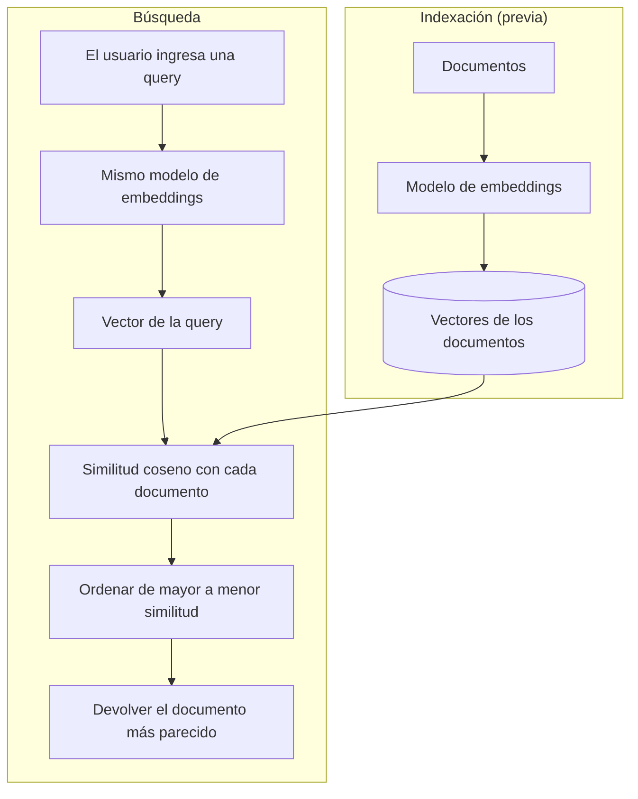

# Oraciones

**Consulta:** "Despliegue de microservicios"

| ID  | Tipo      | Oración                                                                                                 |
| --- | --------- | ------------------------------------------------------------------------------------------------------- |
| R1  | Relevante | Kubernetes reparte los contenedores de cada componente entre los nodos del clúster.                     |
| R2  | Relevante | Cada pieza independiente de la aplicación se publica en producción mediante su propia imagen de Docker. |
| R3  | Relevante | El pipeline de CI/CD lanza nuevas versiones de la API de pagos sin interrumpir a los usuarios.          |
| R4  | Relevante | Una actualización gradual sustituye las réplicas antiguas del backend de pedidos por las nuevas.        |
| R5  | Relevante | Helm empaqueta la configuración para instalar cada módulo autónomo en distintos entornos.               |
| T1  | Trampa    | El servicio de micro-limpieza es excelente.                                                             |
| T2  | Trampa    | El despliegue de las tropas dejó sin personal a los servicios de emergencia.                            |

Las oraciones relevantes evitan las palabras "despliegue", "microservicio" y "servicio". Las trampas sí las usan, o se parecen a ellas, pero hablan de otra cosa.

## 2. Resultados

Similitud coseno de cada oración con la consulta. Entre paréntesis, su posición en el ranking (1 es la más parecida).

| ID     | Tipo       | Embeddings    | TF-IDF por palabras | TF-IDF por n-gramas |
| ------ | ---------- | ------------- | ------------------- | ------------------- |
| R1     | Relevante  | 0,215 (2)     | 0,045 (5)           | 0,022 (4)           |
| R2     | Relevante  | 0,129 (3)     | 0,079 (3)           | 0,021 (5)           |
| R3     | Relevante  | 0,101 (6)     | 0,117 (2)           | 0,040 (3)           |
| R4     | Relevante  | 0,113 (5)     | 0,039 (6)           | 0,019 (6)           |
| R5     | Relevante  | 0,122 (4)     | 0,000 (7)           | 0,003 (7)           |
| **T1** | **Trampa** | **0,704 (1)** | 0,060 (4)           | 0,254 (2)           |
| **T2** | **Trampa** | 0,091 (7)     | **0,267 (1)**       | **0,428 (1)**       |

TF-IDF no entiende significado, solo compara palabras o fragmentos de texto, y sirve aquí como línea de base. Los puntajes de cada método no son comparables con los de otro; lo comparable es el orden.

## 3. Análisis

**Palabras clave (TF-IDF).** Ocurrió lo esperado: T2 quedó primera con ambas variantes, porque comparte "despliegue" con la consulta aunque hable de tropas. Los n-gramas, que comparan fragmentos de texto, además subieron a T1 al segundo lugar por el parecido entre "micro" y "servicio".

**Embeddings.** Los resultados fueron mixtos:

- **Acierto:** T2 quedó última. El modelo reconoció que "despliegue de tropas" es otro significado, algo que TF-IDF no logró.
- **Fallo:** T1 quedó primera con 0,704, unas tres veces más que la mejor oración relevante (R1, con 0,215). Una causa posible es el parecido entre las palabras "microservicios" y "servicio de micro-limpieza", pero este experimento no lo demuestra.
- **Separación débil:** las 5 oraciones relevantes quedaron entre 0,101 y 0,215, casi al nivel de T2 (0,091). Un umbral fijo de similitud no las habría separado de esa trampa.

**Efecto de la consulta.** Con una consulta más descriptiva, las dos trampas quedaron al final:

> ¿Cómo se publican en producción las piezas independientes de una aplicación usando contenedores?

| R2    | R5    | R3    | R1    | R4    | T1    | T2    |
| ----- | ----- | ----- | ----- | ----- | ----- | ----- |
| 0,713 | 0,363 | 0,348 | 0,336 | 0,241 | 0,096 | 0,029 |

Esta prueba es más favorable que la original, porque la consulta reutiliza vocabulario de R2. Muestra que la formulación influye mucho en el resultado, no que el problema esté resuelto.

**Controles del modelo.** Otras mediciones ayudan a interpretar el resultado:

| Par de textos                                                             | Similitud | Lectura                                                       |
| ------------------------------------------------------------------------- | --------- | ------------------------------------------------------------- |
| "El sistema de archivos está lleno" / "No queda espacio en el disco duro" | 0,439     | Relación detectada sin compartir palabras clave               |
| "El sistema de archivos está lleno" / "Me gusta comer manzanas"           | 0,010     | Sin relación, como se esperaba                                |
| "Hay stock" / "No hay stock"                                              | 0,853     | Confirma la limitación con la negación que describe la unidad |

## 4. Cálculo de la similitud con scikit-learn

`cosine_similarity` recibe dos matrices con un vector por fila y devuelve la similitud de cada par. Por eso un vector suelto se escribe con doble corchete:

```python
from sklearn.metrics.pairwise import cosine_similarity

print(cosine_similarity([[1, 2, 3]], [[2, 4, 6]])[0][0])  # 1.0: misma dirección
print(cosine_similarity([[1, 0]], [[0, 1]])[0][0])        # 0.0: perpendiculares
```

Búsqueda de la oración más parecida (requiere `pip install scikit-learn fastembed`):

```python
import numpy as np
from fastembed import TextEmbedding
from sklearn.metrics.pairwise import cosine_similarity

consulta = "Despliegue de microservicios"
documentos = [
    "Kubernetes reparte los contenedores de cada componente entre los nodos del clúster.",
    "El servicio de micro-limpieza es excelente.",
]

# Consulta y documentos deben usar el mismo modelo: si no, sus vectores no son comparables
modelo = TextEmbedding("sentence-transformers/paraphrase-multilingual-MiniLM-L12-v2")
vectores = np.array(list(modelo.embed([consulta] + documentos)))

similitudes = cosine_similarity(vectores[:1], vectores[1:])[0]
for posicion in np.argsort(-similitudes):
    print(f"{similitudes[posicion]:.3f}  {documentos[posicion]}")
```

La similitud coseno ignora la magnitud de los vectores, algo necesario aquí: este modelo no los entrega normalizados (norma de 3,993 en un texto de prueba).

## 5. Flujo de búsqueda semántica



## 6. Método y limitaciones

- **Modelo:** `paraphrase-multilingual-MiniLM-L12-v2` (384 dimensiones), ejecutado en local con `fastembed` 0.9.1. Se eligió porque admite español y no requiere clave de API.
- **Línea de base:** `TfidfVectorizer` de `scikit-learn` 1.9.1, por palabras y por n-gramas de 3 a 5 caracteres.
- **Muestra pequeña:** son 7 oraciones y 2 consultas, escritas a mano. Sirve para ilustrar el comportamiento, no para medir la calidad general del modelo.
- **Solo vale para este modelo:** no se probó `text-embedding-3-small`, el modelo que menciona la unidad, y otro modelo podría no caer en la misma trampa. Las cifras del ejemplo de la unidad (0,85 y 0,15) son conceptuales; este modelo dio 0,439 y 0,010 para esas oraciones.
